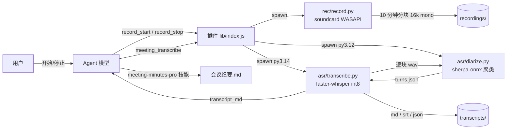

# 会记（dsh-note-taker）实施方案

> 版本 v0.1 ｜ 2026-11-10 ｜ 依据：上次会话（session-bd80c5dd）的结论 + 本机代码与本机实测数据
>
> **一句话**：点一下开始录音，说完点停，本地离线完成转写和音色分人，产出一份带时间轴、决议、行动项的会议纪要。不接飞书、腾讯会议或任何第三方服务。

---

## 1 为什么要自己做一个

生态里这个位置是空的，缺口正好是「音频进」这一段：

| 已有插件 | 能做到 | 缺什么 |
|---|---|---|
| `jetheaven/dsh-meeting-notes` | 文本转 JSON 纪要 | 不处理音频，本体只是一段写死的 prompt（`index.js` 4.8 KB，`src/` 空目录） |
| `satan9394/dsh-meeting-minutes` | 把一份 SKILL.md 打包成插件 | 一行 ASR 代码都没有，README 里写「需先转写」 |
| `dsh-video-to-notes` / `dsh-video-notes` | 现成音视频文件转笔记 | 不能录，输出是笔记不是纪要 |

所以要做的是**把「录音 → 转写 → 分人 → 纪要」这条链路补齐**，而不是再造一个 prompt 封装。

## 2 边界

**要做**：本地麦克风/系统声录音、离线转写（中文）、按音色自动分发言人（无监督聚类，输出 S1/S2…）、生成结构化纪要（Markdown，可选 Word）、历史会议索引、环境体检。

**不做**（明确排除，避免范围漂移）：

- 声纹注册 / 1:N 认真人名（上次已定为方案 A，即纯聚类）
- 任何云端 ASR、云端存储、第三方会议或笔记服务对接
- 实时字幕（边说边出）——列为 V2 候选
- 纪要 prompt 另起一套——直接复用本机 `meeting-minutes-pro` 技能，提示词只维护一份

## 3 现状盘点

### 3.1 已经有的东西

脚手架已在 `D:\workspace\my_workspace\ai_dsh_test\dsh-note-taker`（**建议整体搬到当前工作区**，模型目录可继续沿用）：

| 文件 | 作用 | 状态 |
|---|---|---|
| `package.json` | 包名 `dsh-note-taker`，`dsh.bundle.patch` 指向 patch | ✅ 可直接用 |
| `cordis.patch.yml` | `insert: id=note-taker` | ✅ |
| `lib/index.js` | 注册 4 个工具，spawn Python sidecar，解析 JSON | ✅ 骨架完整 |
| `py/rec/record.py` | soundcard 录音：mic / system / both，stdin 收尾 | ⚠️ 全程缓存在内存，需改 |
| `py/asr/transcribe.py` | faster-whisper int8 + 段落与 turn 按时间重叠对齐，出 txt/srt/json | ✅ 逻辑完整 |
| `py/asr/diarize.py` | sherpa-onnx 切分 + CAM++ + 快速聚类 | ⚠️ 被运行时版本卡住 |
| `py/doctor.py` | 依赖/模型/内存/线程体检 | ✅ |
| `py/get_models.py`、`install_sherpa_offline.py` | 多镜像下模型、离线解包 wheel | ✅ 已把模型下全 |

模型已就位：pyannote segmentation-3.0（7 MB）+ CAM++ 中文（28.3 MB）。

### 3.2 本机实测环境（取自上次会话，开工前用 `doctor.py` 复核一次）

| 项 | 实测值 | 影响 |
|---|---|---|
| CPU | i5-1240P，16 线程（4P+8E） | 限 4–6 线程跑在 P 核，跑满反而慢 |
| 内存 | 总 15.7 GB ／ **可用 3.1–3.3 GB** | **最硬的约束**：`medium` 是上限，`large-v3` 出局 |
| 磁盘 | C: 剩 11.4 GB ／ D: 剩 115 GB | 模型与录音全放 D 盘 |
| GPU | 无 CUDA | 纯 CPU int8 |
| Python | 3.14.5，faster-whisper 1.2.1、ctranslate2 4.8.1、PyAV、onnxruntime 1.29、numpy/scipy | 转写链路零安装 |
| 缺 | `soundcard`（录音）、分人运行时 | 唯一两个缺口 |

> 2026-11-10 本机二次复核：`faster_whisper` / `onnxruntime` / `numpy` 均可用，`sherpa_onnx` 与 `soundcard` 确认缺失，与上表一致。

### 3.3 四个卡点（三个有解，一个已修）

1. **sherpa-onnx 在 Python 3.14 上跑不起来**。2.0.1 和 1.13.8 的 cp314 轮子都报 `requested API version [28] ... only [1,17] supported`，是轮子内嵌 ORT 1.17 与编译头文件不一致，**平台侧打包问题**，换版本无用。
2. **`soundcard` 装不上**：工作区带 `Everyone Deny DeleteSubdirectoriesAndFiles`，pip 的原子 rename 被拦（`Errno 13`）。已有一条验证可行的绕法——`urllib` 下 wheel、`zipfile` 解到 `pylibs`、`PYTHONPATH` 引入。
3. **没有真实会议音频**：Windows SAPI 合成被环境拒绝，`note-taker-data/spike` 下那三个 wav 是否有效未验证，不能当分人基准。
4. **工作区命令跑不了（已修复）**：pwsh 启动即报 `SetNamedSecurityInfoW failed (Win32 5): grantWrite(...)`，是工作区目录缺少当前用户的有效权限。已用一条脚本给 `dsh-note-taker` 补上完全控制权限并复核通过，改动前后备份与恢复命令在 `D:\workspace\my_workspace\dsh-note-taker-acl-logs\`。文件内容、所有者未动。

## 4 架构

三层，插件层只做编排和状态，重活全在 Python，模型侧只看到工具。



关键设计：**分人是一个独立进程，用什么解释器由配置决定**。这样 3.14 的轮子问题被彻底隔离，主链路不受牵连。

## 5 模块与改造点

### 5.1 插件层 `lib/index.js`

保持现有结构（`inject=['tools']`、`ctx.tools.register`），补四件事：

- **录音索引**：`recordings/index.json` 记录 `meeting_id / label / mode / 起止时间 / 文件 / 时长`，让 `audio: "latest"` 真正可用（现在直接抛错）
- **状态机**：`idle → starting → recording → stopping → done/error`，单实例，重复 start 明确报错
- **进度回传**：转写按块推进时把 `[3/7 块]` 打到 stderr 并透传，长会不让人以为卡死
- **超时与内存护栏**：转写前检查可用内存，低于 1.5 GB 自动降档到 `small`

### 5.2 录音 sidecar `py/rec/record.py`

现在是「全部帧堆在 list 里，结束时一次性写 WAV」，1 小时会议峰值约 115 MB 常驻，在 3 GB 可用内存上不划算。改造为：

- 边录边写 `wave` 文件，**每 10 分钟 rollover** 一个块（`xxx.001.wav`、`xxx.002.wav`），峰值内存降到几 MB
- 块级偏移记录在 `manifest.json`，转写时按块时间偏移累加时间戳
- `both` 模式双轨各自 rollover，轨道标签写进 manifest（`mic` 只可能是本房间，`system` 只可能是远端，天然少一类串音）
- 设备热插拔/设备消失要落一条明确错误，不能静默产出半截音频

### 5.3 转写 sidecar `py/asr/transcribe.py`

现有实现已可用（VAD 开、beam 5、`initial_prompt` 支持、分人失败不毁整条链路）。补：

- **逐块转写**：`--input-manifest` 模式，块间串行、结果按偏移合并
- **给分人喂 16 kHz 单声道 wav**：录音本身就是 16k mono，不需要重采样；外部 mp3/m4a 用 PyAV 解一次，写临时 wav 再交给分人进程
- **术语提示**：`--prompt` 由插件侧拼装「参会人姓名 + 项目术语」，建在 `meeting_id` 下可复用

### 5.4 分人 sidecar `py/asr/diarize.py`

`sherpa_onnx.OfflineSpeakerDiarization` 的调用代码不用改，只换运行环境。推荐路线：

> **免安装的独立 Python 3.12 运行时**：python.org embeddable zip 解压到 `note-taker-data/runtime/py312`，再把 `sherpa-onnx` 与 `numpy` 的 cp312 轮子解包进去（复用已有的 `install_sherpa_offline.py` 思路），在 `python312._pth` 里补路径。全程不写注册表、不需要管理员、不走 pip。
>
> 插件通过 `DSH_NOTE_TAKER_DIARIZE_PYTHON` 指向这个解释器，`transcribe.py` 以子进程方式调它并读回 JSON（CLI 入口已经写好了，只需改为传 wav 路径而非数组）。

备选路线，按代价排序：

| 路线 | 代价 | 何时选 |
|---|---|---|
| 独立 3.12 运行时（推荐） | 一次 ~40 MB 下载 + 一条配置 | 默认 |
| 自己用 onnxruntime 1.29 跑切分+CAM+++自写聚类 | 多 1.5–2 人天，零新运行时 | 不想多一个解释器时 |
| 分人整体降级为「双轨区分我/对方」 | 0 | 只要"能分出谁在说"就够时 |

## 6 对外契约

| 工具 | 参数 | 返回 |
|---|---|---|
| `meeting_record_start` | `mode: mic\|system\|both`、`label?` | `meeting_id`、文件路径、开始时间 |
| `meeting_record_stop` | — | `meeting_id`、`files[]`、`duration_s` |
| `meeting_transcribe` | `audio`（路径或 `latest`）、`model`（small/medium，默认 small）、`language`（默认 zh）、`diarize`（默认 true）、`speakers`（0=自动）、`prompt?` | `transcript_md`、`speakers`、`rtf`、`files{md,srt,json}`、`diarize_error?` |
| `meeting_minutes` | `transcript`（路径或 `latest`）、`type?`（周会/评审/1对1…）、`deliverable?`（md/word） | 纪要素材包（转写全文 + 元信息 + 归档路径），正文由 `meeting-minutes-pro` 生成 |
| `meeting_list` | `limit?` | 历史会议索引 |
| `note_taker_doctor` | — | 环境体检报告 |

**错误码**（统一前缀，便于模型判断下一步）：`E_DEP`（缺依赖）、`E_DEVICE`（无录音设备/设备被占）、`E_MODEL`（模型缺失或校验失败）、`E_MEMORY`（内存不足）、`E_AUDIO`（文件不存在或解码失败）、`E_STATE`（录音未开始/已在录）。

**环境变量**：`DSH_NOTE_TAKER_PYTHON`（ASR 解释器）、`DSH_NOTE_TAKER_DIARIZE_PYTHON`（分人解释器）、`NOTE_TAKER_DATA`（数据根，开发期指到工作区）、`NOTE_TAKER_THREADS`（默认 6）。

## 7 产物与数据

```
~/.dsh/note-taker/                    （开发期用 NOTE_TAKER_DATA 指到工作区）
  recordings/<date>-<label>/          xxx.001.wav … manifest.json  index.json
  transcripts/<stem>.{md,srt,json}
  minutes/<stem>-纪要.md
  models/                             faster-whisper/ + 两个分人模型
  runtime/py312/                      免安装分人运行时（可选）
```

产物三件套：`.md`（喂给模型和技能）、`.srt`（可挂播放器）、`.json`（含 `segments_detail` 与 `turns_detail`，供后续改名、导出、回归测试用）。

**保留策略**：录音默认保留 7 天，转写与纪要长期保留；设置项可调，删除走软删。

## 8 关键决策与降级

| 决策 | 结论 | 理由 |
|---|---|---|
| 命名 | 包名 `dsh-note-taker`，中文名「会记」 | npm 上空着，与已占用的 `dsh-meeting-notes` / `dsh-meeting-minutes` 明确区分；note-taker 是英文里的正式角色词 |
| 录音路线 | **Python sidecar（WASAPI loopback）为主** | 一次解决麦克风和系统声；浏览器 `getDisplayMedia` 在 Electron 里要改主进程，插件摸不到 |
| 分人 | 无监督聚类，输出 S1/S2… | 已排除声纹注册；默认人数自动，可传 `speakers` 强约束 |
| 纪要 | 复用 `meeting-minutes-pro` 技能 | 提示词单一来源，插件不重写 |
| 默认模型 | `small` | 3.1 GB 可用内存下最稳；`medium` 作为可选档 |

**降级链**（任一环失败都不该让整条链路死）：

```
内存不足 → medium 降 small
分人失败 → 只出文字+时间轴，标 diarize_error
系统声录不到 → 退回单轨 mic（外放/免提）
soundcard 缺失 → 提示安装，并回落到浏览器 getUserMedia（V2）
```

## 9 里程碑与验收

| 阶段 | 内容 | 验收标准 | 估算 |
|---|---|---|---|
| **M0 环境收口** | 修工作区权限（✅ 已完成）、把脚手架从 `ai_dsh_test` 搬过来、装 `soundcard`、备好 3.12 分人运行时、`doctor.py` 全绿 | 体检 0 项 ❌；分人冒烟脚本跑通 | 0.5 人天 |
| **M1 闭环** | 改造录音分块 + 逐块转写 + 索引，录音→转写跑通 | 3 分钟录音转写 ≤ 90 s；时间戳误差 < 2 s；md/srt/json 齐全 | 1 人天 |
| **M2 分人** | 分人进程接入，段落对齐，未知簇输出「未知-N」 | 3 人对话归属正确率 ≥ 70%；抢话标「多人同时」 | 1 人天 |
| **M3 串联** | `meeting_minutes` + 技能出稿 + `meeting_list` | 一句「整理纪要」产出含决议/行动项的 md | 0.5 人天 |
| **M4 打磨** | 客户端录音条 UI、保留策略、README、打包发布 | 装卸一次通过；非开发者能按 README 跑起来 | 0.5–1 人天 |

合计 3.5–4 人天。**M0 不通过就不该往下写**——三个卡点里任何一个没解，后面全是空转。

## 10 风险

| 风险 | 影响 | 对策 |
|---|---|---|
| 可用内存只有 3.1 GB | 长会议 + 分人并行会压到页交换 | 串行跑、逐块处理、默认 small、转写前内存护栏 |
| sherpa 在 3.14 无解 | 分人不可用 | 独立 3.12 进程隔离；再不行走自写 onnxruntime 或降级双轨 |
| 远场/外放音质差 | 分人基本失效 | 界面上明说「外放录音分人不准」，双轨优先 |
| 录音合规 | 法律与信任风险 | 录前强制确认并留记录；全本地不出机器；保留天数可调 |
| pip 被 ACL 拦 | 依赖装不上 | 沿用「下 wheel + 解包 + PYTHONPATH」，打包成脚本 |
| 无真实音频验证 | 指标全是估算 | 需要 1–5 分钟真实会议录音（wav/mp3/m4a 均可） |

## 11 需要你拍板的三件事

1. **分人运行时**：同意加一个免安装的独立 Python 3.12（~40 MB，只给分人用），还是宁可多花两天用现有 3.14 手写分人？
2. **录音默认档**：默认 `small`（快、稳、够用）还是 `medium`（更准，1 小时会约 15–21 分钟，内存吃紧）？
3. **真实音频**：能否给一段 1–5 分钟的真实会议录音？没有的话我只能验证链路通不通，量不出分人和 RTF 的真实数字。

## 12 V2 候选

实时字幕（边说边出）、说话人改名并回写纪要、Word 导出（技能已支持）、会议纪要自动归档到 Obsidian（可复用 `my-workhub`）、按会议类型自动套模板（技能里已有六类模板）。
